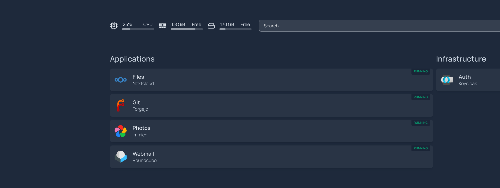

# SmallWorlds

> **Massive Transformative Purpose:** [Every community in control of its digital world.](strategy-paper.md#massive-transformative-purpose)

## Talks

Watch the [SmallWorlds Lightning Talk](https://rawcdn.githack.com/stephan271/smallworlds/30beb50/lightning_talk.html).
> Refer to the [SmallWorlds Architecture Diagram](smallworlds_architecture.md) for system topology and data flows.

# SmallWorlds Setup Guide

<p align="center">
  <br>
  <em>The SmallWorlds dashboard — auto-discovered applications and infrastructure at a glance.</em>
</p>

> [!WARNING]
> **Prototype — not production-ready.** SmallWorlds is still in an early prototyping state. It is intended for experimentation and evaluation only, and is **not yet suitable for production environments**. Expect breaking changes, incomplete hardening, and no stability or upgrade guarantees. Use at your own risk.

> [!IMPORTANT]
> **Not Hetzner-only.** `smallworlds-init.sh` supports two deployment targets: **`hetzner`** (a Hetzner Cloud VM provisioned by Terraform) and **`local`** (an existing Linux machine in your LAN, bootstrapped in place over SSH — no cloud account needed). Hetzner DNS is what **manages public DNS for you** — via Terraform on the `hetzner` target, or via a free Hetzner DNS zone + API token on an **internet-exposed** `local` deployment — but it is optional there: an exposed `local` machine can instead use one wildcard record that you keep yourself, at any DNS provider, with no Hetzner account at all. A LAN-only `local` deployment needs no Hetzner account, no domain registration, and no cloud resources at all. The `local` target also installs a **VPS rented from any other provider** (Contabo, OVH, …), with a firewall set up on the machine. See the "Deployment Instructions" section below and `doc/local-deployment.md` for details.

This document outlines the deployment process for a SmallWorlds GitOps cluster. The architecture relies on an upstream foundation repository and a private, user-controlled configuration repository.

## System Components

This project is built upon several foundational open-source technologies, core infrastructure services (installed by default), and optional user applications (selectively installed during initialization):

### Infrastructure and Cluster Management

| Name | Source URL | Role in this Project |
| :--- | :--- | :--- |
| **Terraform** | [terraform.io](https://www.terraform.io/) | Infrastructure as Code tool used on the `hetzner` target to provision the VM and DNS; on the `local` target only the (optional) DNS zone is Hetzner-managed, the node itself is bootstrapped over SSH without Terraform. |
| **Kubernetes** | [kubernetes.io](https://kubernetes.io/) | Core container orchestration system that serves as the foundation for the cluster. |
| **Argo CD** | [argoproj.github.io/cd](https://argoproj.github.io/cd/) | GitOps continuous delivery tool that synchronizes cluster state with the configuration repository (accessible at `deploy.<domain>`). |
| **Velero** | [velero.io](https://velero.io/) | Cluster backup and disaster recovery solution. |
| **Grafana** | [grafana.com](https://grafana.com/) | Operational dashboard for cluster monitoring and observability. |
| **CloudNativePG** | [cloudnative-pg.io](https://cloudnative-pg.io/) | High-availability PostgreSQL database clustering. |
| **Garage** | [garagehq.deuxfleurs.fr](https://garagehq.deuxfleurs.fr/) | S3-compatible object storage backend. Not deployed when an external S3 provider is chosen at install time. |
| **Homepage** | [gethomepage.dev](https://gethomepage.dev/) | Application dashboard automatically configured and accessible at `dashboard.<domain>`. |
| **Keycloak** | [keycloak.org](https://www.keycloak.org/) | Identity Provider (IdP) for Single Sign-On (SSO) and WebAuthn/Passkey management. |
| **Traefik** | [traefik.io](https://traefik.io/) | Ingress routing and reverse proxy for handling incoming requests. |
| **Cert-Manager** | [cert-manager.io](https://cert-manager.io/) | Automated TLS certificate provisioning and management. |
| **Pod Gateway** | [`tenants/pod-gateway/`](infrastructure/kubernetes/tenants/pod-gateway/) | Append-only personal data pods (`pod.<domain>`). Apps deposit each member's source data into a pod they cannot read; the member's home device pulls it and never deletes. Optional. See [`doc/pod-archive.md`](doc/pod-archive.md). |
| **Operator Console** *(deactivated)* | [`operator-console/`](operator-console/) | **Not deployed since 2026-08-23.** The code, manifests and ADRs are all still here and unchanged, but no cluster runs it — the browser setup wizard (`admin-tools/setup-wizard/`) takes over the install half of what it did, and the observe half is on hold until that lands. See [`docs/adr/0051-a-single-use-setup-wizard-replaces-the-bootstrap-launcher.md`](docs/adr/0051-a-single-use-setup-wizard-replaces-the-bootstrap-launcher.md) and [`doc/tenant-operator-console.md`](doc/tenant-operator-console.md). |

### End User Applications

| Name | Source URL | Role in this Project |
| :--- | :--- | :--- |
| **Collabora Online** | [collaboraonline.com](https://collaboraonline.com/) | Mature online editor with strong OpenDocument support. One of two mutually exclusive Nextcloud Office choices. |
| **Euro-Office** | [euro-office.com](https://www.euro-office.com/) | European collaborative editor for Office and OpenDocument formats. The setup can install it instead of Collabora. |
| **Excalidraw** | [excalidraw.com](https://excalidraw.com/) | Virtual collaborative whiteboard tool. |
| **Forgejo** | [forgejo.org](https://forgejo.org/) | Git repository management and software collaboration. |
| **Immich** | [immich.app](https://immich.app/) | High performance photo and video backup. Photos can run [Gallery](https://github.com/open-noodle/gallery) instead, a fork that keeps the photos in S3. |
| **Jitsi Meet** | [jitsi.org](https://jitsi.org/) | Secure video conferencing and communication platform. |
| **Nextcloud** | [nextcloud.com](https://nextcloud.com/) | File synchronization and collaboration. |
| **Plane** | [plane.so](https://plane.so/) | Open-source project management tool. |
| **Stalwart** | [stalw.art](https://stalw.art/) | Self-hosted mail server with OIDC directory integration. **Optional**, and not installed by default: mail is an opt-in capability ([`docs/adr/0049`](docs/adr/0049-mail-is-opt-in-and-notification-is-not-mail.md)) — onboarding hands out action-token links out of band and alerting pushes over HTTP, so nothing in the cluster needs a mail server. See [`doc/mail.md`](doc/mail.md). |
| **Bulwark** | [github.com/bulwarkmail/webmail](https://github.com/bulwarkmail/webmail) | JMAP webmail client connected to Stalwart. Select Stalwart too — this is the one app that depends on it. |

---

## Deployment Instructions

SmallWorlds supports two deployment targets — you are asked which one you want as the first question:

- **`hetzner`** — a Hetzner Cloud VM provisioned by Terraform, with public DNS and Let's Encrypt certificates. The internet-facing default.
- **`local`** — an existing Linux machine in your LAN (laptop, mini-PC, home server; 32 GB RAM recommended), bootstrapped in place over SSH without Terraform. By default LAN-only: no public DNS (you add router-DNS or `/etc/hosts` entries). Optionally **internet-exposed**: with a registered domain, a Hetzner DNS token and router port forwards (80/tcp, 443/tcp, 10000/udp), an in-cluster DDNS job keeps the DNS records pointed at your home IP. See [`doc/local-deployment.md`](doc/local-deployment.md) for requirements and limitations before you start.

A **server rented from another provider** is the `local` target too: answer yes to internet exposure and yes to the host firewall (in the wizard: "A server you rent elsewhere"). You order the machine and create one DNS record; the installer does the rest. See ["A rented server (VPS)"](doc/local-deployment.md#a-rented-server-vps--docsadr0055).

For that case with S3 storage at Datalix there is a single start-to-finish guide: [`doc/install-contabo-datalix.md`](doc/install-contabo-datalix.md).

Four further choices are made at install time, each recorded in a decision record:

| Choice | Options | Default | See |
|---|---|---|---|
| Where files and backups are kept | The in-cluster Garage (needs a second disk for backups), or an external S3 provider (one disk is enough; the provider can read what is stored) | Garage | [`docs/adr/0053`](docs/adr/0053-object-storage-is-in-house-or-external.md) |
| What Photos runs | Immich (photos on the machine's disk), or Gallery (photos in S3) | Immich | [`docs/adr/0054`](docs/adr/0054-gallery-is-a-variant-of-the-immich-tenant.md) |
| Host firewall | Only for a machine directly on the internet | off | [`docs/adr/0055`](docs/adr/0055-a-rented-server-is-the-local-target-with-its-own-firewall.md) |
| DNS records (exposed `local` machine) | Managed through Hetzner DNS, or one wildcard record you create yourself — no Hetzner account | Managed | [`docs/adr/0056`](docs/adr/0056-dns-can-be-kept-by-hand.md) |

> [!NOTE]
> These four are new. Three of them — an external S3 provider, Gallery and the host firewall — were installed together for real once, on a rented server on 2026-10-11, with DNS managed through Hetzner. The cluster came up with every application healthy; that is one install, not a track record. **DNS kept by hand has not been used on a real install, so no certificate has been issued over HTTP yet.** Treat a first install as a trial.

There are two ways to install, and they do the same thing — **the wizard runs the scripts**, so there is one install code path, not two.

The application step offers one explicit Office choice for Nextcloud Files:
**Collabora**, **Euro-Office**, or **no online editor**. Collabora and Euro-Office
share `office.<domain>` and are never deployed together; choosing either also
selects Nextcloud. Re-running setup safely switches the declared Argo CD
Application and connector while retaining the inactive app's overlay directory
for an easy rollback.

### The setup wizard (recommended)

```bash
git clone https://github.com/stephan271/smallworlds.git
cd smallworlds
./smallworlds-setup
```

The Apps step includes an interactive 3D community globe. Each selected app
adds a miniature continent with a matching landmark, roads, moving cars and
people. Drag or use the arrow keys to rotate, use the zoom buttons to look
closer, and select an app in the globe legend to inspect its neighbourhood.
Pause stops the animation; reduced-motion preferences are respected. The
preview uses locally bundled Three.js and needs no external assets or build
step. If WebGL is unavailable, a Canvas renderer keeps the same scene interactive
with simpler lighting and a lower frame rate. If neither rendering mode is
available, app selection remains usable with a text notice.

A browser opens on `127.0.0.1`. Five panels ask for your domain, your email address, where the cluster should run, a Git access token, and which applications your community gets; everything else is defaulted and sits behind *Advanced settings*. It creates the private settings repository for you, checks your answers against the real APIs before anything is created, shows you exactly what it will do, then installs and hands you the credentials.

The checks are the part worth having: whether your registrar actually delegates the domain to Hetzner DNS (get this wrong and every certificate stays pending with nothing saying why), whether the tokens work, whether an S3 provider accepts your key, and whether your data and backup directories are on different physical disks (not required with an external S3 provider). Each of those otherwise fails minutes into an install.

If the install stops, the page says what to do about it; fix that and press **Install again** on the same page. It carries on from where it got to.

**The install is not the last step.** A fresh cluster has no member accounts, and on an internet-facing machine SSH and the Kubernetes API are still open. What remains — joining the cluster's private network, closing those ports, inviting members — has an order that matters; see "After the install" below.

Prerequisites are the same as the scripted route below, minus the manual steps the wizard does for you (creating the settings repository, creating the DNS zone, uploading the SSH key). You still need to **register the domain yourself** and point its nameservers at Hetzner — see step 1.

### The scripted route

The wizard is a front end for these two scripts; running them directly is fully supported and is what you want for automation. Both also run headless with `SMALLWORLDS_NONINTERACTIVE=1`, taking their answers from their cache files and exiting **78** naming any required value that is missing.

Steps 1 and 3 below apply to the **hetzner** target only; steps 2 and 4 apply to both.

### 1. Domain Registration & DNS Configuration (hetzner target only)

> [!IMPORTANT]
> **Domain Registration is manual:** SmallWorlds does **not** register or reserve the domain name for you — neither the wizard nor the scripts. You must manually register the domain at a registrar of your choice (e.g., Hetzner Domain service, Namecheap, Cloudflare) and point the domain's Nameservers to Hetzner's DNS servers (e.g., `helium.ns.hetzner.de`, `oxygen.ns.hetzner.com`, `hydrogen.ns.hetzner.com`).
> Domain registration will incur costs at your registrar.
> For a LAN-only **local** deployment none of this applies — the domain never has to be registered, since name resolution happens inside your LAN. For an internet-exposed local deployment, or for Let's Encrypt certificates on a LAN-only one, domain registration and the Hetzner nameservers ARE required (records are then managed by the in-cluster DDNS job instead of Terraform).

The DNS zone and DNS records are automatically managed via the Hetzner API token provided during provisioning (which is free of charge). Subdomains are routed to the provisioned server IP.

A `.dev` cluster additionally gets its own scoped mail domain: addresses are `user@dev.<domain>`, with MX/SPF/DKIM/DMARC records placed under the `dev` subdomain so they can never conflict with production's mail records at the zone apex (see `doc/tenant-stalwart.md`).

### 2. Configuration Repository Initialization
A private Git repository is required to store application state and configuration overrides.

Execute the initialization script from the root of this repository:
```bash
./admin-tools/prepare-community-repo.sh
```
This script handles:
- Prompting for your target domain (e.g. `smallworlds.network`) and environment extension in subdomain syntax (e.g. `.dev` for a dev cluster, giving hostnames like `identity.dev.smallworlds.network`; leave empty for production).
- Automatically creating a private GitHub repository using the `gh` CLI (if installed), or allowing you to provide an empty Git URL manually. (The wizard creates it through the GitHub API instead, so it does not need `gh`.)
- Interactive selection of optional applications.
- Generation of the corresponding `kustomization.yaml` overlays, injecting environment-specific patches for the chosen domain.
- Initialization of the local Git repository and automatic push to your remote repository.

### 3. Infrastructure Provider Setup (hetzner target only)
For the **local** target, skip this section — instead make sure the target machine meets the requirements in `doc/local-deployment.md` (systemd Linux, SSH + sudo access, firewalld disabled or configured for k3s, 100 GB+ free disk, and a second disk for backups unless you chose an external S3 provider).

For the **hetzner** target, these steps are required:
1. Create a Hetzner Cloud account and a new project.
2. Generate an API Token with **Read & Write** permissions. Save this token.
3. Nothing else. The Primary IP — the community's permanent public address — is created for you: `smallworlds-init.sh` looks for `smallworlds-ip` (or `smallworlds-ip-dev` for a `.dev` environment — Hetzner resource names always use the dash form, regardless of the DNS syntax), and creates it if it is not there, in a location that can actually build the node. If you would rather create it yourself in the Console, do: it is adopted rather than duplicated, and it then decides where the node goes.

**Where the node ends up.** Hetzner regularly sells a server size out in one location while the others still have it, so the location is not hard-coded. The installer asks the API which of Nuremberg (`nbg1`), Falkenstein (`fsn1`) and Helsinki (`hel1`) can currently supply the node size, takes the first that can, and creates the Primary IP there. All three are in the EU, so member data stays inside it.

Once the Primary IP exists it pins the choice: it is datacenter-bound, and it is the address every DNS record, the PTR and the tailnet point at. If that location later has no capacity, the installer stops before creating anything and tells you where the hardware is — moving there means deleting the Primary IP in the Console and re-running, which gives you a new address and rewrites every record to match. **Rebuilding the node.** cloud-init runs only on a node's first boot, and the server ignores later changes to its user-data — so a change to the bootstrap template (`infrastructure/cloud-init/k3s-node.yaml.tpl`) reaches a running node by exactly one route: replacing it. Run `SMALLWORLDS_REPLACE_NODE=1 ./smallworlds-init.sh`. Terraform detaches both volumes, deletes the server, creates the new one and re-attaches — doing it by hand in the Console fails, because Hetzner refuses to delete a server while volumes are attached. Both volumes and the Primary IP survive, so the community keeps its data and its address; anything living only on the node's own disk does not, and Argo CD re-deploys the cluster from your overlay. Use this rather than `destroy-cluster.sh`, which takes the volumes with it.

**The node size is remembered.** If a node is already running, the installer keeps the size it is — re-running is not a request to resize it — and otherwise reuses the size the last run chose. Only `HETZNER_SERVER_TYPE=...` in the environment changes it, which is how you ask for a resize deliberately. To pin a location, set `HETZNER_LOCATIONS="fsn1 nbg1"` the same way. Type names are Hetzner's own and lowercase (`cpx42`, not `CPX42`) — the installer folds the case for you and, if the name is one Hetzner does not know at all, says so rather than reporting it as sold out. If the capacity lookup itself cannot be answered, the install continues and lets the Hetzner API give the real answer; only a definite "nowhere" stops it.

**DNS records follow your app selection.** Only the applications you chose get an A record, alongside the always-installed `identity`, `dashboard`, `monitoring`, `deploy` and `vpn` (plus the apex on production). A record for `photos.<domain>` with no Immich behind it sends members to a certificate error and makes the zone read as though the app were installed. Selecting an app later adds its record on the next run.

### 4. Cluster Provisioning

> [!WARNING]
> Before your **first** run against a fresh `hetzner` node (or a first-time internet-exposed `local` node), make sure your overlay repo (`my-community-config`, from step 2) is pinned to the **latest** `smallworlds` release tag — see "Managing Updates" below. Some infrastructure-level changes (cloud-init) take effect immediately on a brand-new node, while their corresponding ArgoCD-managed component only appears once your overlay's pinned tag includes it. If those are out of sync at first boot, the result isn't a degraded app or two — it can be a total outage (e.g. every TLS certificate stuck, no app reachable) with nothing obviously pointing at the cause. A newly created overlay may not have caught up via the weekly Renovate PR yet, so check/bump it manually first. The wizard pins the newest release by default, so this applies mainly to the scripted route.

Execute the bootstrap script to provision the server and install Kubernetes/ArgoCD. On the `hetzner` target it provisions the VM and DNS via Terraform; on the `local` target it bootstraps your LAN machine over SSH (asking for its SSH target, e.g. `root@192.168.1.50`, or `localhost` to install on the machine you are running the script on).

```bash
git clone https://github.com/stephan271/smallworlds.git
cd smallworlds
./smallworlds-init.sh
```
When prompted for Git credentials, provide:
- **URL**: The HTTPS URL of your private configuration repository (SSH URLs are unsupported).
- **Username**: Your Git platform username.
- **Access Token**: A Personal Access Token (PAT) with read-only access to repository contents.

### 5. After the install

The cluster is running, but not ready to use: nobody has an account yet, and on an internet-facing machine SSH and the Kubernetes API are still open. Do the rest in this order — [`doc/install-contabo-datalix.md`](doc/install-contabo-datalix.md) steps 7 to 14 give every command for a rented server. On the `hetzner` target only the command that closes the ports differs, and `setup-vpn.sh` prints it.

1. **Save the admin passwords** the installer showed. `admin` and `operator` are Keycloak's own administrators: they work at `identity.<domain>/admin/` only and cannot sign in to the dashboard or any application.
2. **Join the node to the cluster's private network** with `./admin-tools/setup-vpn.sh`. The operator interfaces — Argo CD at `deploy.<domain>`, Grafana at `monitoring.<domain>`, Keycloak administration — answer only to devices on it, and `403` to everyone else ([`doc/hardening.md`](doc/hardening.md)).
3. **Join your own computer**, and check that SSH, `kubectl` and the operator interfaces work over that network.
4. **Close SSH and the Kubernetes API to the internet** — only after step 3, which is your proof that the other way in works.
5. **Invite the members** on the Invitation Desk at `join.<domain>/desk` ([`doc/tenant-join.md`](doc/tenant-join.md)). Each member gets a one-time code (a message, a QR code or a printed card), chooses their own username, registers a passkey and writes down recovery codes; nobody has a password and no mail is sent. The Desk is an operator page, so it answers only on the private network — which is why it comes after step 3.
6. **Check from outside** that the operator interfaces answer `403`.

A LAN-only machine behind a router skips steps 2 to 4 and 6: nothing of it faces the internet.

### 6. Authentication Configuration
By default, registration is invitation-only (step 5 above). To enable self-registration, patch the Keycloak configuration via your `kustomization.yaml`:

```yaml
patches:
  - target:
      kind: Job
      name: keycloak-realm-config
      namespace: keycloak
    patch: |-
      - op: replace
        path: /spec/template/spec/containers/0/env/1/value
        value: "self-registration"
```

### 7. Custom Application Deployment
To deploy external applications, add standard Kubernetes manifests to your configuration repository and declare them in your `kustomization.yaml`. ArgoCD will synchronize the state.

---

## Maintenance Operations

The rebuild procedures below are for the **hetzner** target (they drive Terraform). For **local** deployments, the equivalent lifecycle (uninstall/reinstall preserving data, full wipe) is described in `doc/local-deployment.md`.

### Rebuild (Preserve Data)
This procedure replaces the VM while retaining the persistent volume containing cluster state and data.
```bash
cd infrastructure/terraform
terraform destroy -target=hcloud_server.smallworlds_pilot_node
terraform apply
```

### Clean Rebuild (Wipe Data, Preserve TLS Certificates)
This procedure wipes all cluster data but first backs up the TLS certificates to your local machine (`~/.smallworlds/cert-backups/<production|dev>/`), then re-injects them into the new cluster to avoid Let's Encrypt rate limits. For the dev cluster, prefix each command with `ENV_EXT=".dev"`.
```bash
./admin-tools/prepare-fresh-rebuild.sh
cd infrastructure/terraform
terraform destroy -target=hcloud_server.smallworlds_pilot_node
terraform apply
cd ../.. && ./admin-tools/restore-certs-from-laptop.sh
```
The restore script waits for the new cluster's API, then applies the saved certificate secrets before cert-manager re-issues them; if no local backup exists it exits cleanly and certificates are issued fresh. You can also snapshot certificates at any time without a rebuild via `./admin-tools/backup-certs-to-laptop.sh`.

### Backups & Storage

Storage layout, the backup chain, restore procedures and scaling paths are all
documented in [`doc/storage-and-backup.md`](doc/storage-and-backup.md). With the default storage mode the chain is
Garage-first: databases (CloudNativePG/barman), Velero's cluster-state dumps and
nightly PV copies all land in the in-cluster Garage S3, and a single replicator
CronJob mirrors every bucket offsite at 04:00.

With an **external S3 provider** (`docs/adr/0053`) there is no Garage and no
replicator: the same producers write straight to buckets at the provider, named
`<prefix>-…`, so backups are off the machine from the start. Set up versioning
and an expiry rule on those buckets at the provider yourself — the install does
not — and consider a second provider for the backup side, which both setup
routes offer. The notice below applies to the Garage mode only.

> [!IMPORTANT]
> **The offsite leg requires one-time operator setup** — an S3 target (recommended:
> a Backblaze B2 bucket with versioning) and the `replicator-config-secret`.
> Until then, backups never leave the node and the nightly replicator job fails
> (which the monitoring emails about). Follow
> [`infrastructure/kubernetes/tenants/backup-replicator/README.md`](infrastructure/kubernetes/tenants/backup-replicator/README.md).

To exercise a destructive, three-user restore of Immich and Nextcloud on a
fresh disposable Hetzner cluster, run `./admin-tools/restore-drill.sh all`. It
uses central all-user Recovery Points on a physically separate backup volume,
not personal pod archives, and destroys the cloud resources after recording the
result. See the restore procedures above for scope and safety checks.
The latest recorded run is the [2026-09-01 Immich + Nextcloud restore
drill](docs/restore-drills/2026-09-01-immich-nextcloud.md).

### Managing Updates — the two-repo model

SmallWorlds runs on **two repositories**, and understanding their interplay is the key to safe day-2 operations:

| Repo | Role | Who changes it |
| :--- | :--- | :--- |
| **`smallworlds`** (this repo, public) | The upstream **base**: all app/infra manifests under `infrastructure/kubernetes/`. Released as semver tags (`v1.0.0`, `v1.1.0`, …). | The SmallWorlds project. |
| **`my-community-config`** (yours, private) | The **overlay** ArgoCD actually deploys from. Each app's `kustomization.yaml` remote-references the base at a **pinned tag** (`?ref=v1.0.0`) plus your local patches. | You, the operator. |

Each cluster (production, `.dev`) has its own private overlay repo, generated the same way by `prepare-community-repo.sh` with the matching environment extension.

**ArgoCD only watches your private overlay.** It does *not* track the base's moving branch. Because the overlay pins the base to an **immutable tag**, upstream changes never reach your cluster on their own — adopting a new base version is always a deliberate, auditable action in *your* repo.

> [!NOTE]
> This separates two independent concerns. **Drift reconciliation** (ArgoCD `selfHeal`) keeps the cluster matching whatever is *declared* and stays on — it's safe and low-risk. **Version adoption** (moving to newer upstream code) is the deliberate lever described below. Don't conflate them.

#### Adopting a new release manually

Bump the pinned tag everywhere in your overlay and commit — ArgoCD (which watches this repo) then syncs the change deterministically:

```bash
# in my-community-config, e.g. v1.0.0 -> v1.1.0
grep -rl 'v1.0.0' . | xargs sed -i 's#v1.0.0#v1.1.0#g'
git commit -am "Bump upstream smallworlds base to v1.1.0" && git push
```

Rollback is just as simple: revert that commit. Because the ref is immutable, what you tested is exactly what deploys.

> [!TIP]
> `prepare-community-repo.sh` pins to a release tag by default (it prompts for the version). You *can* answer `HEAD` to always track the latest `main`, but avoid it in production: ArgoCD only re-pulls a floating `HEAD` non-deterministically (on cache expiry), so you lose reproducibility and can't tell what's actually running.

#### Automated weekly update proposals (Renovate)

An in-cluster **Renovate** CronJob is pre-wired to reduce the toil without giving up control. Every Monday it opens **one pull request** in your private overlay that bumps the pinned base tag to the newest `smallworlds` release (config in `my-community-config/renovate.json`). It does **not** auto-merge — you review the changelog and merge when ready; the merge is the commit that triggers ArgoCD. This gives you a low-effort cadence *and* a human gate *and* a full audit trail.

Requirements for the PR automation:
- The private overlay must be listed in the Renovate CronJob's `RENOVATE_REPOSITORIES` (added via an overlay patch in your `kustomization.yaml`, so operator-specific config stays out of the public base).
- The Git token Renovate uses (`repo-git-creds`) must have **pull-request / write** access to the private overlay repo, not just read.

---

## Administrative Tools (`admin-tools/`)

The `admin-tools/` directory contains helper scripts to automate common operations and maintenance tasks:

### Cluster Lifecycle & Disaster Recovery
- **`backup-certs-to-laptop.sh`**: Downloads Let's Encrypt certificates from the cluster to your local machine to avoid rate limits during rebuilds.
- **`restore-certs-from-laptop.sh`**: Injects previously backed-up certificates into a newly built cluster before cert-manager re-issues them.
- **`prepare-fresh-rebuild.sh`**: Prepares a cluster for a clean reinstall by backing up certificates and wiping all persistent application data on the server.
- **`destroy-cluster.sh`**: Wraps the cluster teardown process. It automatically backs up your certificates and then safely executes `terraform destroy` to delete the cloud resources.
- **`build-golden-image.sh`**: Builds a pre-configured Hetzner snapshot (golden image) to speed up future VM provisioning.

### Setup
- **`setup-wizard/`**: The browser setup wizard behind `./smallworlds-setup` — five panels with live validation, driving the two setup scripts rather than reimplementing them. Python standard library only, no dependencies and no build step. See [`docs/adr/0051-a-single-use-setup-wizard-replaces-the-bootstrap-launcher.md`](docs/adr/0051-a-single-use-setup-wizard-replaces-the-bootstrap-launcher.md) for why it replaced the Operator Console.
- **`generate_storage_patches.py`**: Writes the overlay patches that point a cluster at an external S3 provider instead of Garage, and removes them again. Called by `prepare-community-repo.sh`; see [`docs/adr/0053`](docs/adr/0053-object-storage-is-in-house-or-external.md).
- **`test-object-storage.py`**: Tests the storage choice and the Gallery variant: renders the patched overlays against the real manifests and runs the bucket-provisioning job scripts against stub `kubectl` and `curl`.
- **`test-setup-wizard.sh`**: Tests the wizard's server, defaults and plan, then walks its five panels in a real browser using the Playwright installed for `e2e-tests/` (skipped when absent).
- **`setup-vpn.sh`**: Joins an internet-facing node to the cluster's own private network (Headscale), creates `admin.<domain>` and prints how to join your computer and close the public admin ports. Logs in the way the installer did, as root or as a user with passwordless sudo.
- **`test-bootstrap-pins.sh`**: Checks `infrastructure/bootstrap-pins.env` — the K3s and Argo CD a new node installs — and that every bootstrap path uses it; `--online` re-checks the pinned checksums against upstream.
- **`test-local-bootstrap-preflight.sh`**: Tests the local bootstrap's check for a firewall that would cut pods off from the Kubernetes API.
- **`test-noninteractive-install.sh`**: Asserts that both setup scripts run with no tty under `SMALLWORLDS_NONINTERACTIVE=1`, that a missing required value exits 78 naming it, and — over a pty — that interactive mode is unchanged.

### Repository & Version Management
- **`prepare-community-repo.sh`**: Interactive script to initialize a new private configuration repository, select applications, and wire it up to the upstream base. Also runs non-interactively (`SMALLWORLDS_NONINTERACTIVE=1`), which is how the setup wizard drives it.
- **`bump-version.sh`**: Automatically detects the highest release tag, increments the patch version, creates a new Git tag, and pushes it to origin.
- **`update-community-version.sh`**: Updates all `kustomization.yaml` files in your private config repository to pin them to a specific upstream release, then commits and pushes the change.

### Utilities
- **`test-pr-locally.sh`**: Deploys a local testing environment to validate pull requests.
- **`generate_domain_patches.py`**: Automatically generates Kustomize domain patches for all applications when a non-default domain or environment extension (e.g., `.dev`) is used.
- **`bulk-invite.py`**: The terminal route for inviting members — creates accounts from a CSV and writes one-time passkey links (optionally QR codes). The Invitation Desk (`join.<domain>/desk`, [`doc/tenant-join.md`](doc/tenant-join.md)) is the everyday route. Needs the private network, because it uses Keycloak's administration interface.
- **`update_realm_json.py`**: Python utility for Keycloak realm manipulation.

---

## End-to-End Smoke Tests

Browser-based Playwright smoke tests simulate real users logging in via SSO and exercising each application. They live in `e2e-tests/tests` and run against a **live** SmallWorlds community.

```bash
./e2e-tests/run-smoke-tests.sh <domain> [keycloak-admin-password]

# e.g.
./e2e-tests/run-smoke-tests.sh smallworlds.network
```

If the Keycloak admin password is omitted, the runner reads it from the cluster via `kubectl`. The script checks service availability, provisions two test users (`sw-test-alice`, `sw-test-bob`), and runs the suite.

### OIDC test depth (two-tier)

Full OIDC login roundtrips require the applications to trust the TLS certificate of `identity.<domain>` for their server-side discovery/token calls. That holds in production (Let's Encrypt) but is structurally impossible on ephemeral staging clusters. The suite therefore runs at one of two depths:

| Mode | How to run | What it verifies |
| :--- | :--- | :--- |
| **Shallow wiring** (default) | `./e2e-tests/run-smoke-tests.sh <domain>` | Each app redirects into Keycloak's authorize endpoint — proving client config, secrets, issuer URL, in-cluster DNS, and OIDC wiring. The deeper login-roundtrip tests are skipped. |
| **Full OIDC** | `FULL_OIDC=1 ./e2e-tests/run-smoke-tests.sh <domain>` | The complete login roundtrips run — auto-login into each app, then asserting the app's authenticated UI loads (Files listing, inbox, timeline, dashboard, etc.). Requires app-trusted certificates, i.e. production. |

In shallow mode you'll see the roundtrip tests reported as **skipped** (with the reason `Full OIDC roundtrip needs app-trusted certificates — run with FULL_OIDC=1`); this is expected, not a failure.

### Other options

These environment variables override the CLI arguments:

| Variable | Effect |
| :--- | :--- |
| `DOMAIN` | Target domain (alternative to the first positional argument). |
| `KC_ADMIN_PASS` | Keycloak admin password (alternative to the second positional argument). |
| `FULL_OIDC=1` | Run the full OIDC login roundtrips (see above). |
| `HEADED=1` | Run in headed browser mode instead of headless. |
| `SLOWMO=500` | Slow operations down by the given number of milliseconds — useful when watching a headed run. |
| `SKIP_PROVISION=1` | Skip test-user provisioning (reuse existing `sw-test-*` users). |
| `KUBECONFIG` | Path to the kubeconfig used to read the admin password (default: `~/.smallworlds/kubeconfigs/<production\|dev>.yaml`, matching the configured `env_ext`). |

The HTML report is written to `e2e-tests/reports/html`; view it with `cd e2e-tests && npx playwright show-report reports/html`.

---

## Developer Guide: Cutting a New Release

A SmallWorlds release is a Git tag. There is nothing to build, sign or attach: an operator installs from a checkout, and a cluster follows the tag its overlay pins. See [`docs/adr/0057-bootstrap-inputs-are-pins-in-the-repository.md`](docs/adr/0057-bootstrap-inputs-are-pins-in-the-repository.md).

### Step 1 — Review the bootstrap pins

[`infrastructure/bootstrap-pins.env`](infrastructure/bootstrap-pins.env) names what a new node installs before Argo CD takes over: the K3s version, the K3s install script and the Argo CD manifest, each with the SHA-256 the download must have. Every install route reads it, and the node refuses a file that does not match.

Most releases leave it alone. Confirm that it still matches upstream:

```bash
admin-tools/test-bootstrap-pins.sh --online
```

To move to a newer K3s or Argo CD, change the version, the URL and the digest together, and compute the digest yourself from the official source:

```bash
curl -fsSL "<url>" | sha256sum
```

Pin the K3s installer by **commit**, never as `https://get.k3s.io`: that address serves whatever `install.sh` is on K3s's main branch today, so the digest stops matching the next time upstream edits the script and every install then fails its checksum. Use `https://raw.githubusercontent.com/k3s-io/k3s/<commit>/install.sh`, with the commit from `https://github.com/k3s-io/k3s/commits/master/install.sh`. When Argo CD moves, update its image in `infrastructure/golden-image/images.txt` as well.

A changed pin reaches new and rebuilt nodes only; a running node keeps the K3s and Argo CD it has.

### Step 2 — Tag the release

```bash
./admin-tools/bump-version.sh        # tags main with the next patch version and pushes
```

### Step 3 — Write the release notes

Give operators a human-readable summary — what changed, and anything that affects an upgrade (backup-model changes, newly optional apps, breaking renames, a pin that moved):

```bash
gh release create v1.2.44 --title "SmallWorlds v1.2.44" --notes-file <notes.md>
```

The deploy works without this, but the [Releases page](https://github.com/stephan271/smallworlds/releases) is where operators read what a bump will do to them.

### Step 4 — Let operators adopt it

Publishing does not deploy anything. Each operator's private overlay pins an immutable tag, so the new release only reaches a cluster when someone bumps that pin — either manually or by merging the weekly Renovate PR. See "Managing Updates — the two-repo model" above.

> [!NOTE]
> **The Operator Console and its launcher are deactivated** ([ADR 0051](docs/adr/0051-a-single-use-setup-wizard-replaces-the-bootstrap-launcher.md)), and nothing in a release is built for them. Their publishing workflows (`publish-operator-console.yml`, `publish-bootstrap-launcher.yml`), the launcher packaging script and the release signing key remain in the repository unused. Releases up to `v1.2.43` carried signed bootstrap archives for the launcher; the procedure that produced them is in this README at that tag.

---

## Developer Guide: Adding a New Application

When adding a new application (tenant) to the SmallWorlds cluster, please ensure you complete all the items on this integration checklist:

- **Pin Specific Versions**: Always use a specific, stable container image tag (e.g., `v2.4.1` or `24.04`) rather than `latest` in your Kubernetes manifests to ensure reproducible deployments.
- **Add E2E Tests**: Write end-to-end smoke tests (using Playwright) in the `e2e-tests/tests` directory to verify the application's core functionality and SSO integration.
- **Integrate with Dashboard**: Add Homepage annotations (e.g., `gethomepage.dev/enabled: "true"`) to the application's Ingress resource so it automatically appears in the user dashboard.
- **Make it Selectable**: Add the application's identifier to the `OPTIONAL_APPS` array in the `admin-tools/prepare-community-repo.sh` script so users can easily toggle its installation.
- **Update the README Table**: Add the application to the "End User Applications" table in this README file, including a description and its source URL.
- **Document the Implementation**: Add a descriptive markdown file (or update an existing one) in the `doc/` directory detailing the application's YAML manifests, configurations, and architecture.
- **Configure DNS Records**: Add the application's generic subdomain (e.g., `whiteboard`, `meet`, `office`) to the DNS records array in `infrastructure/terraform/main.tf` so Terraform provisions the A-record.
- **Provision Web Certificates**: Ensure the Ingress resource specifies the correct `cert-manager.io/cluster-issuer: letsencrypt-prod` annotation and the `tls` hosts block to automate Let's Encrypt SSL certificate generation.
