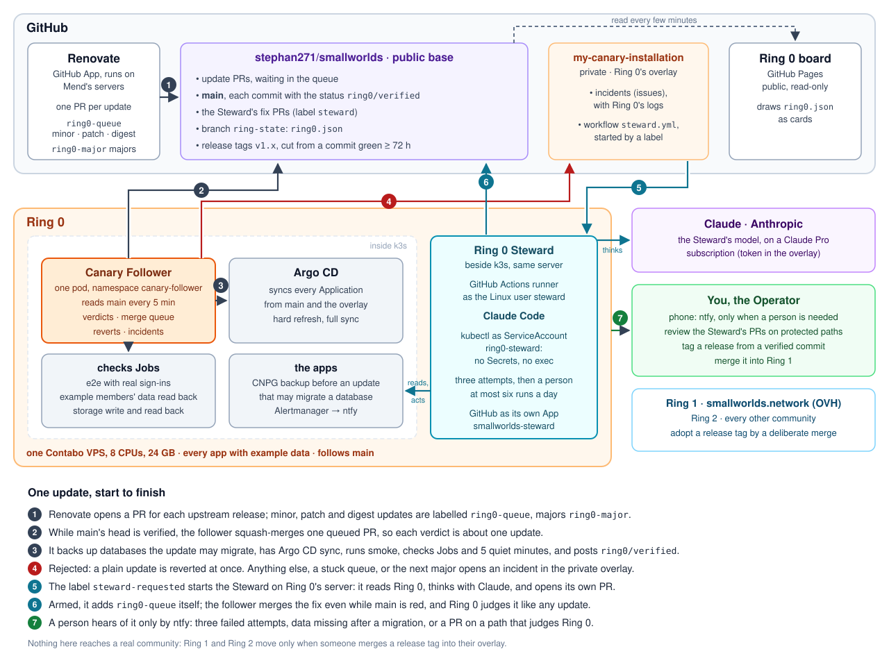

# Automatic updates: who does what, and where it runs

The base repository updates itself. Renovate proposes each upstream release.
Ring 0, the canary cluster, merges them one at a time, verifies each, and takes back what
fails. When Ring 0 cannot move on by itself, the Ring 0 Steward, an AI agent on
Ring 0's own server, fixes forward through a PR of its own. A person hears of it
only when that fails. No real community is touched by any of this: Ring 1 and Ring 2 move only
when their Operator takes what Ring 0 verified, step by step with the
[Update Desk](#taking-it-to-your-community-the-update-desk) on their own machine, or by
merging a release tag into their overlay.

This page is the overview. The details live with each part:
[canary-follower README](../infrastructure/kubernetes/tenants/canary-follower/README.md),
[Steward README](../admin-tools/canary/steward/README.md),
`plans-and-walkthroughs/design-update-strategy.md` (rings, ADR 0060) and
`plans-and-walkthroughs/design-per-app-updates.md` (§5, the Steward, ADR 0064).



## What runs where

| Part | Runs on | Does | Credentials |
|---|---|---|---|
| **Renovate** | GitHub App, Mend's servers | opens one PR per upstream release; labels minor, patch and digest updates `ring0-queue` and majors `ring0-major` (`renovate.json`). It never merges. | the App's installation on the base repository |
| **Canary Follower** | Ring 0, one pod in the namespace `canary-follower` inside k3s | reads `main` every 5 minutes; verifies each new commit; posts `ring0/verified`; merges one queued PR per green commit; reverts; opens incidents; publishes `ring0.json` | a fine-grained token on the base repository (statuses, contents, PRs, issues, workflows) and on the overlay (issues); Ring 0 only |
| **Checks Jobs** | Ring 0, Jobs cut from suspended CronJobs | e2e suite with full OIDC sign-ins, `seed.py check` (the example members' data read back), storage checks | the Secret `canary-checks` |
| **Argo CD** | Ring 0, inside k3s | syncs every Application from `main` and Ring 0's overlay, when the follower asks | — |
| **Ring 0 Steward** | Ring 0's server, **beside** k3s: a GitHub Actions runner as the Linux user `steward`, running Claude Code | diagnoses an incident; acts on Ring 0; opens fix PRs; prepares majors | ServiceAccount `ring0-steward` (no Secrets, no exec); its own GitHub App `smallworlds-steward`; a Claude Pro token |
| **Claude** | Anthropic | the model the Steward thinks with | `CLAUDE_CODE_OAUTH_TOKEN` in the overlay's secrets |
| **Incidents** | issues in the private overlay `my-canary-installation` | the evidence (Ring 0's logs, so never in the public repository) and the incident's state | — |
| **Steward workflow** | `.github/workflows/steward.yml` in the overlay (copy of `admin-tools/canary/steward/steward.yml`) | starts when the follower labels an incident `steward-requested` | — |
| **Ring 0 board** | GitHub Pages, <https://stephan271.github.io/smallworlds/> | draws `ring0.json` from the branch `ring-state` as cards; public, read-only | — |
| **Alerts** | Ring 0's Alertmanager → ntfy | `CanaryCommitFailed` (warning) and `Ring0NeedsPerson` reach the Operator's phone | `monitoring/smallworlds-notify` |
| **Update Desk** | each Operator's own computer, only while they use it (`./smallworlds-update`) | takes a community along Ring 0's verified path, one step at a time | the Operator's own git, kubeconfig and a read-only GitHub token |

Nothing else runs continuously. During the drills, Claude Code watched Ring 0 by
polling the GitHub API from the Operator's laptop (`gh api …/status`, the
incident's labels, the Steward's PRs). Those watchers belonged to that session and
are not part of the system. To watch Ring 0 yourself, use the board, the
`ring0/verified` statuses on `main`, the incidents in the overlay, and ntfy.

## One update, start to finish

1. **Proposal.** Renovate opens a PR for an upstream release, at least three
   days after it was published, so a withdrawn release never arrives.
2. **Merge.** While `main`'s head is verified and nothing else is in flight, the follower
   squash-merges the oldest PR labelled `ring0-queue` that passed its PR checks.
   One update per commit means each verdict is about one update.
3. **Verify.** For the new head the follower:
   - backs up every CNPG cluster of a tenant whose database the update may migrate;
   - hard-refreshes and fully syncs every Application, and waits until all of them are Synced and Healthy;
   - waits for the node's load to settle;
   - smoke-tests every Ingress host;
   - runs the checks Jobs;
   - waits through 5 quiet minutes without a critical alert;
   - confirms WAL archiving.

   A full cycle takes 20–25 minutes, which is about 40 updates a day.
4. **Verdict.** `ring0/verified` on the commit: `success`, `failure` (rejected)
   or `error` (could not be judged; tried again in an hour).
5. **Rejected.** The PR is labelled `ring0-rejected-<fingerprint>` and never merged
   again. The next step depends on the commit:
   - A plain update is **reverted** at once by a revert PR the follower merges.
   - An update that touches a migrating tenant (immich, gallery, nextcloud, forgejo, stalwart, keycloak) is **not** reverted: the way back is the pre-update backup. It becomes an incident.
   - A person's commit gets a revert PR that is not merged, and an incident.
6. **Incident.** An issue in the private overlay, with the evidence. Its kind decides
   whether Ring 0 pauses:

   | Kind | When | Ring 0 |
   |---|---|---|
   | S1 | `main`'s head was rejected and not reverted | pauses |
   | S2 | an error outlasted its retries | pauses |
   | S3 | queued updates, nothing merged for a day | pauses |
   | S4 | a queued PR red or unmergeable for 12 hours | keeps going |
   | R | an update was rejected and reverted | keeps going |
   | M | the oldest major, offered while Ring 0 is idle | keeps going |

7. **Steward.** The follower labels the issue `steward-requested`; the workflow
   starts on Ring 0's runner. The Steward reads the evidence and the cluster,
   decides, and either acts on Ring 0 (a sync, a deleted pod) or opens a PR labelled
   `steward` with the line `Ring0-Incident: #N`. It answers with a comment
   `<!-- steward-done result=… -->`.
8. **Fix.** With `STEWARD_ARMED` the Steward adds `ring0-queue` to its own PR. The
   follower merges it even though `main` is red (only that PR), and Ring 0 verifies
   it like any update. A verified fix closes the incident by itself.
9. **Person.** After three failed attempts, or at once when data is missing after
   a migration or the next step is not the Steward's, the issue is labelled
   `ring0-needs-person` and `Ring0NeedsPerson` reaches ntfy.

Majors go the same way from step 6 (except those in `.github/`, which stay plain PRs for a person: the Steward may not change workflows): the follower offers the oldest one as an M
incident, the Steward prepares it in a PR of its own (the update plus whatever makes it work, from the
upstream upgrade notes), and the queue merges that PR.

## Where a person still decides

- **Protected paths.** A Steward PR that touches `e2e-tests/`, `admin-tools/canary/`,
  `tenants/canary-follower/`, `renovate.json` or `.github/` waits for the owner's
  approving review, whether it is armed or not. The follower enforces this itself
  (`PROTECTED_PATHS`), so the Steward cannot loosen what judges it.
- **Releases.** `admin-tools/bump-version.sh` tags only a commit that has been
  `ring0/verified` for at least 72 hours. Communities adopt a tag through their own overlay's Renovate PR, by a
  merge (the Follow Policy decides when it is offered), or skip tags and follow
  Ring 0 commit by commit with the Update Desk (below).
- **Restores** with data missing, and anything the Steward hands over.
- **Merging into `main` by hand.** The ruleset "main: admins only" requires admin
  rights; the follower's merges pass it with its token.

## Taking it to your community: the Update Desk

Everything above happens on Ring 0. Your community moves when you move it. The
Update Desk is a page on your own computer that shows every commit of `main`
Ring 0 has verified since the one your community runs, and takes your
community there step by step. Every step ends on a verified commit, so your
community only ever passes through states Ring 0 ran. The decision is
`docs/adr/0067`; the details are in `admin-tools/update-desk/README.md`.

**What you need**, all of it on the computer you installed from:

- the checkout of this repository you installed from (the Desk runs from it
  and reads Ring 0's history after a `git fetch`);
- your overlay checkout (the wizard created it), with push access;
- `kubectl` access to your cluster: the kubeconfig in `~/.smallworlds/kubeconfigs/`.
  Once SSH and the Kubernetes API are closed to the internet, your computer has
  to be on the cluster's private network while you use the Desk;
- a GitHub token, only to read Ring 0's older verdicts from this public
  repository: `gh auth login`, or `GH_TOKEN`. Any token works.

**Running it:**

```bash
cd ~/development/smallworlds && git pull
./smallworlds-update --overlay ~/development/my-community-config \
                     --kubeconfig ~/.smallworlds/kubeconfigs/local.yaml
```

The Desk remembers both paths. Choose how far to go, then press its buttons in
order: **Plan**, **Write the overlay change**, **Commit**, **Push**, **Move the
root pin**, and it follows the rollout until every application is healthy again.
A step that migrates a database offers *Back up now* first and is undone only by
a restore. A step that needs you to do something by hand
(`infrastructure/kubernetes/operator-steps.yaml`) says so before or after.

**Things to know:**

- An overlay that follows `HEAD` cannot be moved step by step, and the Desk
  says so. Pin it to the commit it runs first
  (`doc/install-contabo-datalix.md`, step 15).
- An overlay on a release tag starts its path at that tag. After the first step
  it names commits, and its Renovate Follow Policy goes quiet: the Desk takes
  over.
- Nothing tells you yet that steps are waiting. Your Operator Board
  (`ops.<domain>`) lists the Desk under *Updates* with this command, and the
  [Ring 0 board](https://stephan271.github.io/smallworlds/) shows what Ring 0
  verified last.

## Switches

| Switch | Where | Effect |
|---|---|---|
| `MERGE_QUEUE`, `AUTO_REVERT` | `tenants/canary-follower/config.yaml` | the follower merges, the follower reverts |
| `INCIDENTS` | same | incidents are opened at all |
| `STEWARD` | same | incidents ask the Steward (otherwise they go straight to a person) |
| `STEWARD_MAJORS` | same | majors go to the Steward |
| `STEWARD_ATTEMPTS`, `STEWARD_RUNS_PER_DAY` | same | 3 attempts, 6 runs a day |
| `QUIET_SECONDS` | same | the quiet period, 300 |
| `STEWARD_ARMED` | repository variable on the overlay (Settings → Secrets and variables → Actions → Variables) | `true`: the Steward queues its own PRs. Unset or `false`: you add `ring0-queue` after reading them |
| `STEWARD_MODEL` | same place | optional, the model the Steward runs |

A change in `config.yaml` reaches Ring 0 through `main`, like any commit. The
repository variable takes effect at the next Steward run.

## How far it is proven

| Date | What happened |
|---|---|
| 2026-11-12 | The merge queue merges Renovate's PRs by itself. |
| 2026-11-15 | The Steward runs live, propose-only; its first diagnosis (Keycloak 26.8.2's `kc-admin-api` scope) matched the fix already made by hand. The first major (Forgejo's Redis 8) is prepared and verified. |
| 2026-11-15 | **Drill 1:** a broken Excalidraw Service port. The Steward diagnosed it correctly but handed it to a person instead of opening its own revert. The prompt was fixed (PR #98). |
| 2026-11-16 | **Drill 2:** Bulwark's automatic sign-in switched off. Ring 0 rejected it after 19 minutes (3 e2e tests). The Steward opened its own revert two minutes later, which was merged by the queue and verified, and the incident closed itself. |
| 2026-11-16 | `STEWARD_ARMED=true`. |
