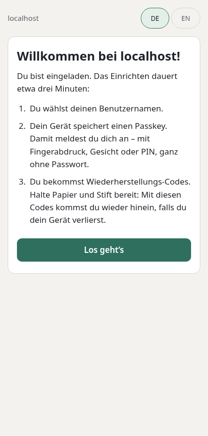
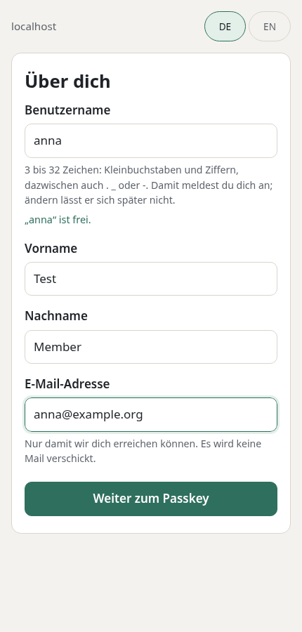
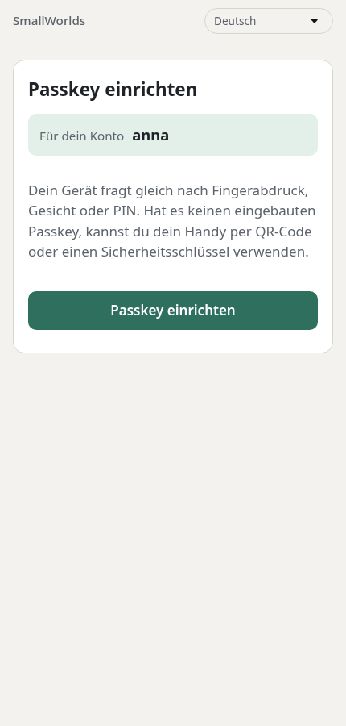
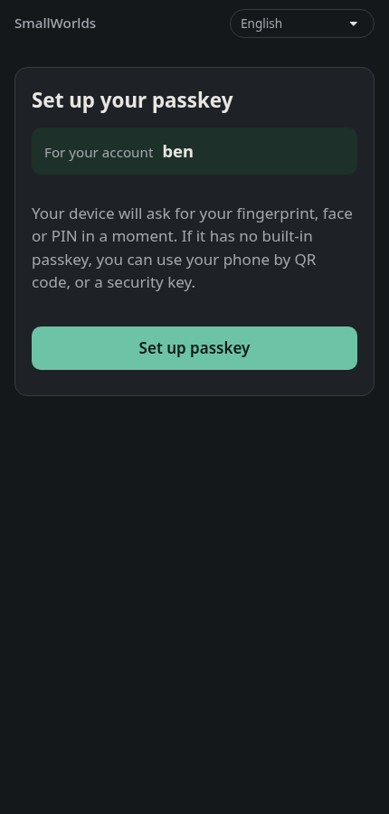
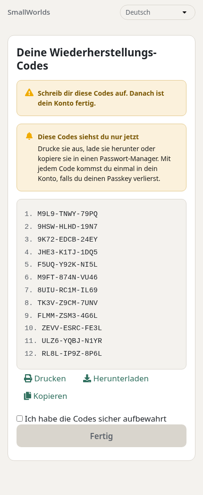
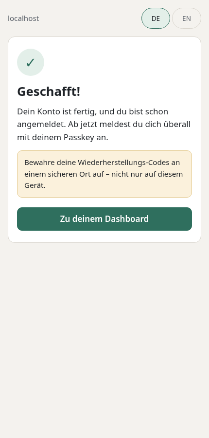
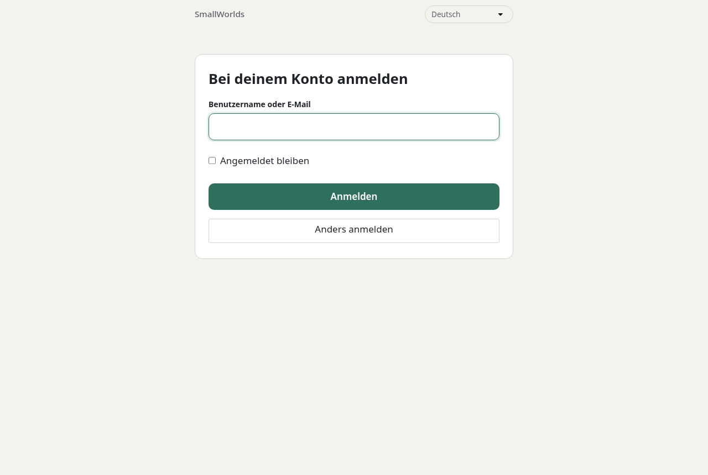

# join — Member Invitations

`join` is how people become members. The Operator issues a **Member Invitation**
on the **Invitation Desk**. The member opens it on the **join page**, chooses a
username, and is sent into Keycloak to register a passkey and take down recovery
codes. Decision: `docs/adr/0058`. Design and rationale:
`plans-and-walkthroughs/design-member-invitations.md`.

It is a Platform Service, deployed on every cluster by `apps/join.yaml` in sync
wave 1, at `join.<domain>`.

## The two halves

| | Join page | Invitation Desk |
| :--- | :--- | :--- |
| Path | `/` | `/desk` |
| Who | the invited member | the Operator |
| Reachable from | the internet | the Private Network only (`join-desk-ingress.yaml`) |
| Port | 8080 (`http`) | 8081 (`desk`), never named by the public Ingress |
| Sign-in | the invitation code | master-realm `operator` (password + TOTP), role `admin` |

Both halves are served by one pod: Python standard library, source from the
`join-src` ConfigMap, pages from `join-static`, running in a stock
`python:3.14-slim` image, as Hermes does. Invitations live in SQLite on the
`join-data` claim, which is deliberately not backed up. Losing it loses open
invitations, never a member.

## What the member sees

Five screens, two of them Keycloak's, all in the language the member chose. The
two Keycloak pages use the `smallworlds` login theme and the action token
handler from `infrastructure/keycloak-spi/action-token-generator`
(`docs/adr/0059`). The screenshots were taken by `tests/live-keycloak.sh`
against a local Keycloak; the recovery codes are from that throwaway instance.

1. **Welcome**, on the join page: what is about to happen, and a hint if the
   device has no built-in passkey.

   

2. **About you**: username (checked live), name and email address.

   

3. **Passkey**, in Keycloak: names the account and says what the device will
   ask. One button, then the device's own dialog. Nothing else is asked.

   
   

4. **Recovery codes**, in Keycloak: twelve numbered codes to print, download
   or copy. **Done** unlocks once the member ticks that the codes are stored.

   

5. **Done**, back on the join page. The member is already signed in, so the
   dashboard and every application open without another passkey prompt.

   

Every later sign-in uses the same theme:



Before `docs/adr/0059` the same invitation took four Keycloak pages, among them
a confirmation page, a pop-up asking for the passkey's name, and a final
"account updated" page (`docs/passkey-screenshot-1.png` to `-5.png`).

## Everyday use

**Inviting.** Open `https://join.<domain>/desk` from a device on the tailnet. It
needs the `/etc/hosts` line for operator pages, which lists `join.<domain>`.
- Enter a name, choose the language, and create the invitation.
- Hand it over: copy the message (or share it), show the QR code, or print a
  card.
- For a group, use **Several** and paste one name per line; then **Print all
  cards**, four to an A4 sheet.

**The code is shown once.** Only its hash is stored. If it is lost, use
**New code** in the list; the old code stops working at once.

**States.**

| State | Meaning |
| :--- | :--- |
| Open | not opened yet |
| Started | an account exists, but has no passkey yet; opening the invitation again carries on with it |
| Done | Keycloak holds a passkey for the account |
| Expired | the validity passed (default 14 days, at most 30) |
| Withdrawn | revoked by the Operator |

**A member locked out** (device and recovery codes both lost):
1. Find them under **New passkey for a member**.
2. Keep "remove the old passkeys" checked unless you are sure the device is
   destroyed. That also ends all their sessions.
3. Send the recovery invitation like any other.

**From a shell** — for scripting, or when the Desk is unreachable:

```bash
kubectl -n join exec deploy/join -- python /app/manage.py create --locale de --label "Anna"
kubectl -n join exec deploy/join -- python /app/manage.py list
kubectl -n join exec deploy/join -- python /app/manage.py revoke 7
```

`list` shows each state as last recorded. A passkey registered since then is
noticed the next time the invitation is opened or the Desk lists it.

`admin-tools/bulk-invite.py` still works and is independent of `join`.

## Keycloak wiring

The Keycloak side has two parts: the clients below, and the provider jar
`tenants/keycloak/action-token-generator.jar`, built from
`infrastructure/keycloak-spi/action-token-generator` by its `build.sh`. The jar
carries the link endpoint, join's token type `smallworlds-join` with its
handler, and the `smallworlds` login theme. `build.sh` also writes the jar's
checksum into `tenants/keycloak/values.yaml`; Keycloak loads providers only at
start-up, and the changed annotation is what restarts it.


| Client | Realm | Created by | Used for |
| :--- | :--- | :--- | :--- |
| `join` | smallworlds | `bases/keycloak-client-job` (secret `keycloak-secret`) | service account (`manage-users`, `view-users`, `query-users`); redirect `https://join.<domain>/*` |
| `join-desk` | master | `join-keycloak-setup-job.yaml` | the Desk's sign-in (public, PKCE); redirect `/desk/callback`, sign-out `/desk/signed-out` |

- `join` talks to Keycloak over `keycloak-keycloakx-http.keycloak`, never
  through Traefik.
- Every link it mints must begin with the public issuer
  (`PUBLIC_IDENTITY_URL`) and is refused otherwise.
- Links carry `kc_locale`, and the account carries a `locale` attribute, so
  Keycloak's passkey pages are in the member's language. This needs the realm
  to support `de` and `en`; `realm-config-job` sets that.

**Token:** `join` asks for `tokenType: smallworlds-join`. Its handler skips
Keycloak's confirmation page and ends with a sign-in and a redirect to
`/done/<lang>` instead of an "account updated" page. The token is single-use.
An older jar ignores the field and mints Keycloak's own execute-actions token,
which still works, with the extra pages.

**Required actions:** `webauthn-register-passwordless`, then
`CONFIGURE_RECOVERY_AUTHN_CODES`. There is no `UPDATE_PROFILE`: the join page
collects username, first and last name and email itself, because the realm's
user profile requires them.

## Security notes

- **The code travels in the URL fragment** (`join.<domain>/#XXXXX-XXXXX`). It
  never reaches Traefik's access log or Loki.
- **The public API never accepts an account ID.** It acts only on the account
  the invitation records.
- **Failed code lookups are limited** to 20 per source address per hour.
- **The Desk is protected twice:**
  - the allow-list
  - the `admin`-role sign-in, because the allow-list also admits the node's LAN
    and cluster addresses
- **`join-networkpolicy.yaml`** admits Traefik only, and lets the pod reach only
  cluster DNS and Keycloak.
- **An account is deleted by the Desk only** if its own invitation created it
  and it holds no passkey.

After a first deployment, check from outside the tailnet:

```bash
curl -s -o /dev/null -w '%{http_code}\n' https://join.<domain>/desk/   # 403
curl -s -o /dev/null -w '%{http_code}\n' https://join.<domain>/        # 200
```

## Rolling out a change to an existing cluster

An overlay that follows `HEAD` of this repository through a fixed overlay
commit does not see a change here on its own:
- Argo CD caches the rendered manifests under the overlay's revision, so it
  needs a hard refresh (`argocd.argoproj.io/refresh=hard` on the Application).
- What it then finds counts as drift. Self-heal re-applies only the drifted
  objects, so **Sync hooks such as `join-keycloak-setup` and Keycloak's
  `realm-config` do not run**. A change to a hook needs a full sync of that
  Application.

## When something is wrong

| Symptom | Cause | Fix |
| :--- | :--- | :--- |
| Join page says "The service cannot be reached" | Keycloak down, or the NetworkPolicy blocks it | `kubectl -n join logs deploy/join` |
| The link opens Keycloak with "invalid link" | Issuer or redirect mismatch | Check `PUBLIC_IDENTITY_URL` and `JOIN_URL` in `join-config`, and the `join` client's redirect URIs |
| Desk: "This account may not issue invitations" | Signed in with a master account without `admin` | Sign in as `operator` |
| Desk answers `403` from your computer | Not on the tailnet, or no hosts line for `join.<domain>` | As for `deploy.<domain>` |
| `join-keycloak-setup` keeps failing | The `join` client does not exist yet | It waits for `keycloak-client-init`; check that job's log |

## Tests

`admin-tools/test-join.sh` runs four suites; none touches a cluster:
- server tests for both listeners, against `tests/fake_keycloak.py`
- a browser walk of the join page
- a browser walk of the Desk, on a routed `https://` origin

`tests/live-keycloak.sh` walks whole invitations against a real Keycloak in
Docker. It uses the version from `values.yaml`, this repository's realm and
the jar, and a virtual passkey. Run it after changing the extension or the
theme, and on every Keycloak upgrade.
