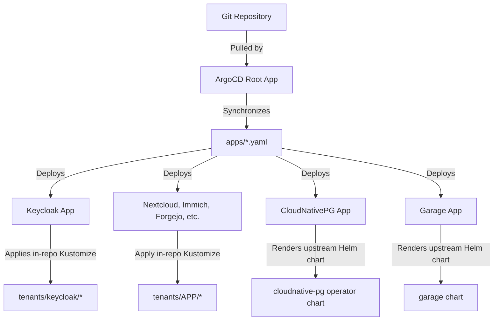
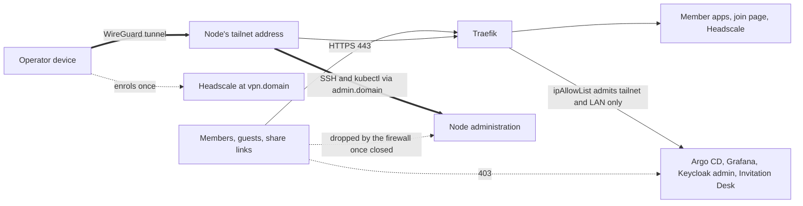
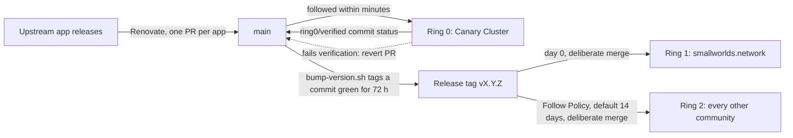
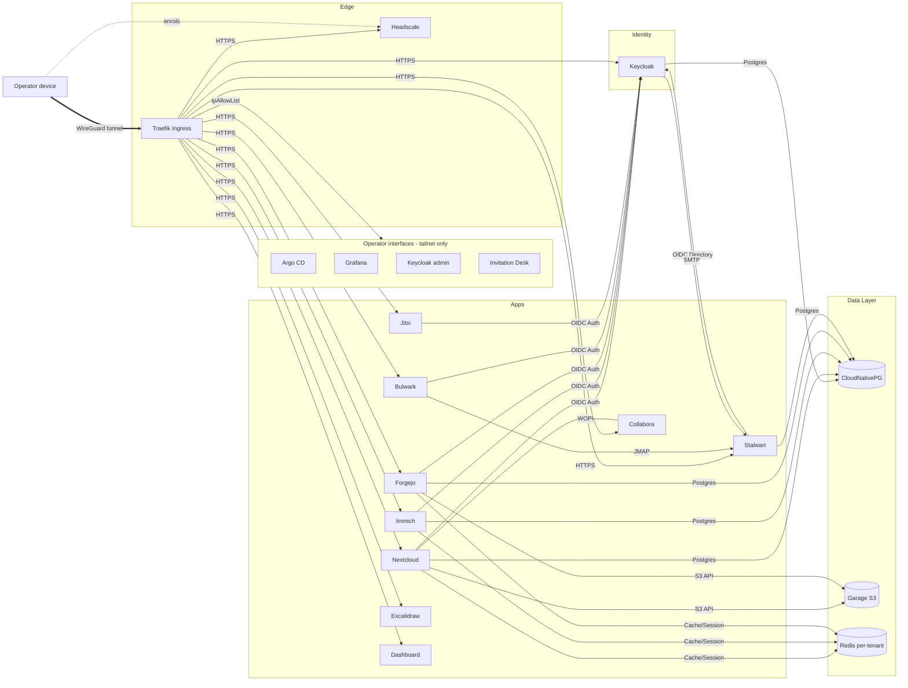

# SmallWorlds Architecture

A deep dive into the GitOps workflow, ArgoCD setup, the private operator network, the release rings, and the collaboration between infrastructure components.

> This is the GitHub-rendered version of the architecture guide. A styled standalone HTML version is also available at [`smallworlds_architecture.html`](smallworlds_architecture.html) (open it locally — GitHub serves `.html` as source, not a rendered page).

## 1. The GitOps Bootstrap (ArgoCD Setup)

The entire SmallWorlds cluster is managed declaratively using ArgoCD. The initialization sequence ensures that as soon as the Kubernetes (K3s) cluster boots, it immediately pulls its desired state from your Git repository.

**`infrastructure/cloud-init/k3s-node.yaml.tpl`** (shared by the production/dev and staging terraform roots)

When the VM boots, Cloud-init installs K3s and immediately applies the ArgoCD installation manifest. Once ArgoCD is running, it applies the `argocd-root-app.yaml`. K3s automatically processes any manifest dropped into `/var/lib/rancher/k3s/server/manifests/`, making this the perfect hook for our root application.

**`/tmp/argocd-root-app.yaml` (generated via cloud-init)**

This root Application defines the **App of Apps** pattern. It points ArgoCD to the repository defined by `git_url` and watches the root directory. This tells ArgoCD to synchronize all the application definitions found in `infrastructure/kubernetes/apps/`.

## 2. The App of Apps Architecture

The `infrastructure/kubernetes/apps/` directory contains individual ArgoCD `Application` manifests for every component in the cluster. Most of these — the end-user apps and Keycloak — point to a specific in-repo tenant directory (e.g., `infrastructure/kubernetes/tenants/keycloak/`) rendered with Kustomize. The core operators (CloudNativePG, Garage, Traefik, cert-manager, the monitoring/logging stacks) instead reference an upstream Helm chart directly, so they have no in-repo `tenants/` directory.

> **Two kinds of Application.** In-repo tenants (all the end-user apps plus Keycloak) point at an `infrastructure/kubernetes/tenants/<name>` directory rendered with Kustomize. Core operators — **CloudNativePG, Garage, Traefik, cert-manager, kube-prometheus-stack, loki-stack** — instead reference an **upstream Helm chart** directly; there is no in-repo `tenants/` folder for them.

## 3. Core Infrastructure Components Integration

The foundation of the cluster relies on three main pillars working together: Storage, Routing, and Databases.

**Persistent Storage — Local Node Storage**
`persistent-storage.yaml` creates a `StorageClass` named `static-local` (formerly `hetzner-local`; renamed since it is not Hetzner-specific). This maps Kubernetes PVCs to a local path at `/mnt/smallworlds-data` on the node, with `PersistentVolume` node affinity covering both provisioning targets — the Hetzner VM (`cc-pilot-node-01`) and a bootstrapped LAN machine (`smallworlds-local-node`) — ensuring data survives VM recreation or a local reinstall.

**Networking — Traefik & Cert-Manager**
`traefik.yaml` and `cert-manager.yaml` manage routing and TLS. Cert-manager watches for Ingress resources and automatically negotiates Let's Encrypt certificates. Traefik serves as the unified entry point for all subdomains (identity, files, photos, etc.).

**Databases — CloudNativePG (CNPG)**
Instead of deploying disparate database instances, the cluster uses CNPG. For example, Keycloak's tenant directory contains `cnpg-cluster.yaml` which tells the operator to spin up a highly available Postgres cluster exclusively for Keycloak. Nextcloud, Immich, and Forgejo follow this identical pattern.

**Object Storage — Garage S3**
`garage.yaml` deploys an S3-compatible object store. Each tenant provisions its own storage in isolation: every app runs its own `garage-init-job.yaml` (from the shared `bases/garage-init-job` base) during its sync phase, which uses the Garage CLI to create that tenant's own bucket plus a dedicated `postgres-backups-<tenant>` bucket, and generates S3 access keys stored in per-tenant K8s secrets (`garage-secret`, `garage-secret-cnpg`). This per-app isolation means one tenant's credentials never grant access to another's data.

## 4. Identity Provider (Keycloak) Configuration

Keycloak is the heart of the SmallWorlds authentication architecture. Every application delegates its login flow to Keycloak via OpenID Connect (OIDC).

**`infrastructure/kubernetes/tenants/keycloak/smallworlds-realm.json`**

This massive JSON file defines the entire state of the identity provider. Key integrations include:

- **OIDC Clients:** Pre-registers clients for `nextcloud`, `immich`, `forgejo`, and `dashboard`. It defines their redirect URIs and client secrets.
- **Passkey (WebAuthn) Flow:** Overrides the default browser flow to enforce passwordless WebAuthn authentication.
- **SMTP Integration:** Configured to use the internal DNS name of Stalwart (`stalwart-mail.stalwart.svc.cluster.local:25`) to send invitation emails. The SMTP password is injected dynamically from a Kubernetes secret using `sed` (substituting `${env.STALWART_PASSWORD}` in the realm JSON) during the `realm-config-job`.

**`infrastructure/kubernetes/tenants/keycloak/realm-config-job.yaml`**

Because the Realm JSON is static in Git, this post-sync job executes the Keycloak Admin CLI (`kcadm.sh`) to import the JSON and dynamically patch in sensitive secrets (like the Stalwart SMTP password and Bulk Invite secrets) without exposing them in the repository.

## 5. Application Collaboration & Integration

Here is how the applications wire themselves into the core infrastructure defined above:

**Nextcloud**
The base install is driven by its Helm `values.yaml` (CNPG Postgres via environment variables, primary storage mapped to its Garage S3 bucket). OIDC, however, is wired up after install by the `oidc-config-job.yaml` hook, which uses `kubectl exec` + `php occ` to install the **`user_oidc`** app, register the `smallworlds` provider against Keycloak's discovery URL, and read the client secret from the `keycloak-secret` Kubernetes secret.

**Immich**
Immich lacks declarative configuration for OIDC in its Helm chart. Therefore, an **ArgoCD Sync Hook** (`admin-init-job.yaml`) runs a script that hits the Immich REST API. It creates the initial admin user, logs in to get a JWT, and then submits a JSON payload to the `/api/system-config` endpoint to enable OIDC and bind it to Keycloak.

**Bulwark & Stalwart Mail**
Stalwart mail is wired to Keycloak as an **OIDC Directory**, configured imperatively by the `stalwart-init-job` via the Stalwart CLI (not via a static TOML file). Bulwark (the webmail UI) is a JMAP client configured via environment variables: it authenticates users against Keycloak in OIDC-only mode using the shared `keycloak-secret`, and talks JMAP to Stalwart at `mail.<domain>`.

## 6. Network Separation: Public Apps, Private Operator Interfaces

A SmallWorlds cluster is deliberately on the public internet — but not all of it. Every hostname falls into one of two classes:

- **Member applications stay public.** Share links have to reach people who are not members, and members open the apps from phones and work laptops. Onboarding must not require installing anything.
- **Operator interfaces are private.** Argo CD (`deploy.<domain>`), Grafana (`monitoring.<domain>`), Keycloak administration (`identity/admin`, `identity/realms/master`) and the Invitation Desk (`join/desk`) answer only to devices on the cluster's own tailnet — and `403` to everyone else.

**The tailnet — Headscale.** `apps/headscale.yaml` (sync-wave `0`) deploys Headscale, the open-source Tailscale coordination server, at `vpn.<domain>`. It is the only publicly reachable piece of the private network, because devices enrol through it. Devices run the standard Tailscale client (`tailscale login --login-server=https://vpn.<domain>`) and talk to the node over WireGuard; no third-party service decides who is on the network.

**How the restriction is enforced.** Every operator Ingress carries a Traefik `ipAllowList` middleware admitting the tailnet (`100.64.0.0/10`), private LAN ranges and loopback. That only works because Traefik sees each visitor's real address: its Service sets `externalTrafficPolicy: Local` (`apps/traefik.yaml`). With the default, kube-proxy rewrites every outside source to a `10.42.x` cluster address, which the allow-list admits — the whole internet got in that way until it was found on 2026-10-11. **After any change to Traefik's Service, check from outside that `deploy.<domain>` answers `403`.**

The Invitation Desk shares its host with the public join page, so it is served on a port of its own (8081) that the public Ingress never routes to: a dropped private router fails closed instead of falling through to the internet.

**Closing SSH and the Kubernetes API.** Right after an install both are still open, because nothing else reaches the machine yet. `admin-tools/setup-vpn.sh` — a deliberate step once Argo CD has deployed Headscale — joins the node to the tailnet, points `admin.<domain>` at the node's tailnet address and prints how to enrol the Operator's computer. Once SSH and `kubectl` work over the tailnet, the public admin ports are closed:

| Target | How 22 and 6443 close |
|---|---|
| Rented server (`local` target with `HOST_FIREWALL`, ADR 0055) | `smallworlds-firewall close` on the node. It refuses unless the calling session itself arrived over the tailnet — that session is the proof the way back in survives. `smallworlds-firewall open` reverses it. |
| Hetzner | Apply with `public_admin_ports = false`, which drops 22 and 6443 from the `hcloud_firewall`. |
| LAN machine behind a router | Nothing to close — neither port is exposed. |

Tailnet traffic arrives on its own interface and is never filtered, so administration keeps working. **Order matters:** tailnet before closing the ports, and tailnet before inviting members, because the Invitation Desk is an operator page (`doc/install-contabo-datalix.md` steps 7–14).

Details: [`doc/hardening.md`](doc/hardening.md), [`doc/local-deployment.md`](doc/local-deployment.md).

## 7. Updates: Three Release Rings

The two-repo model already guarantees that nothing reaches a community by accident: an overlay only moves when its pinned tag is bumped. The release rings add the missing stage in between — **an update has to prove itself on a cluster with data before anybody's members depend on it** ([ADR 0060](docs/adr/0060-updates-move-through-three-release-rings.md), status *proposed*; design in [`plans-and-walkthroughs/design-update-strategy.md`](plans-and-walkthroughs/design-update-strategy.md)).

| Ring | Instance | Data | Follows | Adopted by |
|---|---|---|---|---|
| **0** | Canary Cluster (Contabo Cloud VPS 8, `.canary.smallworlds.network`) | Example data, never re-seeded | `main`, automatically | Nobody — it is automatic |
| **1** | smallworlds.network | Real members | Every release, on the day it is tagged | The project's Operator, by merging the overlay PR |
| **2** | Every other community | Real members | Releases older than its **Follow Policy** (default 14 days) | Its Operator, by merging the overlay PR — or never |

**Ring 0 tests upgrades, not installs.** Ephemeral staging (`test-pr-locally.sh`) builds a fresh cluster every time, so it cannot see a migration that breaks existing data — which is how an update actually hurts a community. Ring 0 runs every supported application at once on the same machine type and install route (the setup wizard, `local` target with `HOST_FIREWALL`) as the communities it protects, and keeps its data across every update. Where two choices exclude each other, it runs Ring 1's side (Gallery, Euro-Office); the other side gets fresh-install tests only, and the release notes say so. It runs on its own machine, because cluster-wide components (cert-manager, CNPG, Traefik, Argo CD) make a canary on the production host a production update.

**The Canary Follower** (`tenants/canary-follower`, Ring 0 only; stdlib Python from a ConfigMap, the pattern of `join` and `pod-gateway`) polls `main`. On a new commit it hard-refreshes every Application and runs a full sync — Argo CD neither notices a new commit in a remote Kustomize base nor runs hooks without that — waits for `Synced`/`Healthy`, smoke-tests every Ingress host from inside the cluster, waits out a quiet period with no `critical` alert, and reports the outcome as the GitHub commit status `ring0/verified`.

**The release gate.** `bump-version.sh patch|minor|major [--security]` (`admin-tools/lib/ring0_gate.py`) cuts a release only from the newest commit of `main` that has been green on Ring 0 for 72 hours — a full backup cycle, every nightly job twice; `--security` shrinks that to one green verification. The version number now carries meaning: **patch** = fixes only, **minor** = feature updates or migrations, **major** = an Operator must act. `admin-tools/release-notes.py` drafts per-application release notes from what the two tags actually deploy, including the Ring 0 verdict and which variants were soaked; a human finishes them.

**Rings 1 and 2 never adopt automatically, and never roll back automatically.** Adoption is always a merge in the GitOps Overlay — the audit trail and the rollback point. Most applications migrate their database forward on start, so an automatic image rollback on a real community could turn a failed update into lost data. Only Ring 0, which holds no member data, reverts by itself.

| Piece | State (2026-11-10) |
|---|---|
| Ring 0 installed, overlay on `?ref=HEAD` | done |
| Canary Follower: follow, converge, smoke, quiet period, commit status | built |
| Release kinds and the Ring 0 gate in `bump-version.sh`; `release-notes.py` | built |
| Canary Follower: in-cluster e2e, data checks, automatic revert | planned |
| Follow Policy question (wizard, `prepare-community-repo.sh`) | planned |
| `PreSync` database backup before every update; post-update alert and per-app rollback runbooks | planned |

## System Topology Map

